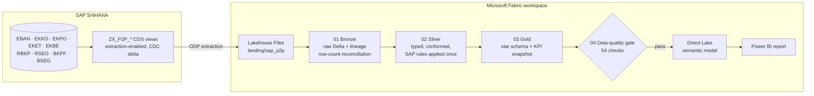
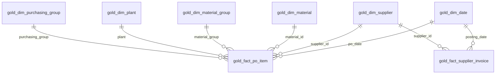

# Procure-to-Pay Analytics: SAP S/4HANA → Microsoft Fabric

[](https://github.com/bigmike2307/sap-p2p-fabric-analytics/actions/workflows/ci.yml)

End-to-end Procure-to-Pay (P2P) analytics for a UK food manufacturer: **SAP CDS extraction views → Fabric Lakehouse (bronze / silver / gold) → Direct Lake semantic model → Power BI**, with an automated data-quality gate that reconciles every KPI before the report refreshes.

The data is synthetic but follows real SAP conventions (zero-padded keys, `YYYYMMDD` dates, debit/credit indicators, price units, inverted exchange-rate dates), so the pipeline handles the same problems a live S/4HANA system creates.

> **Kestrel Foods** is fictional: 3 UK sites, 92 suppliers, about £25m spend a year. No client data, code or screenshots from any employer are used in this repository.

---

## The business questions

| Question | Who asks it | KPI |
|---|---|---|
| Are we buying through requisitions and POs, or raising the PO after the invoice turns up? | Procurement director | PR-backed rate, after-the-fact POs |
| Which suppliers deliver on time *and* in full? | Supply chain / planning | On-time %, OTIF % |
| How much is sitting on GR/IR, and how old is it? | Financial controller | GR/IR balance and aging |
| How many invoices fail first-time match, and are we paying any twice? | AP manager | First-time match %, duplicate suspects |
| Are we paying on time, or too early and giving away working capital? | Finance director | Paid on time %, paid early %, days to pay |

## What the analysis found

Figures from the generated dataset (`--seed 42`, Oct 2024 to Sep 2026, £51.2m spend).

- **£1.05m was committed after the invoice arrived.** 280 PO lines had an invoice dated before the PO. Indirect & Services is the hotspot: 13% of its lines are after-the-fact, and 40% have no requisition.
- **Short deliveries cost 8 points of OTIF.** On-time is 82.8% but OTIF is 74.6%, and the gap sits mostly in Ingredients (82.7% → 73.4%). 11 of the 67 regular suppliers are below 70% OTIF, and they hold 20% of spend.
- **£434k of GR/IR is more than 90 days old.** 99 receipts were never invoiced. These need chasing or writing back before year end.
- **60 duplicate invoices (£304k) were all paid.** The supplier reference had been keyed in a different format (`INV-004512` vs `4512`), so SAP's exact-match duplicate check missed them. 27 had been payment-blocked and were released anyway.
- **Match exceptions drive late payment.** 61% of blocked invoices are paid late, against 19% of clean ones. Fixing price variances at source improves supplier relationships and the Prompt Payment Code position.
- **£3.7m was paid an average of 25 days early**, which is working capital given away for no discount.

## Architecture



A Fabric Data Pipeline runs notebooks 01 → 04 in sequence and refreshes the semantic model only if the quality gate passes. Setup steps are in [`fabric/README.md`](fabric/README.md).

## What this project demonstrates

| Area | Where to look |
|---|---|
| **SAP data** | [`sap_cds/`](sap_cds): extraction-enabled CDS view entities with automatic change data capture; MM and FI table knowledge (EKBE event types, AREWR clearing values, BKPF-AWKEY links, BSEG in S/4HANA) |
| **Data engineering** | [`fabric/notebooks/`](fabric/notebooks): PySpark medallion pipeline, idempotent overwrite loads, lineage columns, row-count reconciliation |
| **Data modelling** | Star schema with conformed dimensions, unknown members, UK fiscal calendar (April–March) |
| **Business analytics** | 24 P2P KPIs with written definitions ([`docs/kpi_definitions.md`](docs/kpi_definitions.md)) and DAX measures ([`powerbi/`](powerbi)) |
| **Testing and quality** | 54 automated checks, including reconciling every KPI against an independent implementation; CI runs the whole pipeline on every push |
| **Platform** | Fabric Lakehouse, notebooks, Data Pipelines, Direct Lake, Git integration and deployment pipelines |

## Data model



| Fact | Grain | Built from |
|---|---|---|
| `gold_fact_po_item` | PO item | EKKO, EKPO, EKET, EBAN, EKBE (goods and invoice receipts), RSEG/RBKP |
| `gold_fact_supplier_invoice` | Supplier invoice | RBKP, BKPF → BSAK (payment), TCURR |

## SAP conventions handled in silver

| SAP convention | Example | Rule |
|---|---|---|
| Dates as `YYYYMMDD`, `00000000` = empty | `EINDT = 20250314` | `DATE`, `NULL` when initial |
| Leading zeros (ALPHA conversion) | `LIFNR = 0000100023` | key kept, display number without zeros |
| Debit/credit indicator, not a sign | `SHKZG = H` on a 102 GR reversal | signed quantities and amounts |
| Price unit | `NETPR = 180.00` per `PEINH = 1000` | unit price = `NETPR / PEINH` |
| Inverted rate validity date | `GDATU = 79749168` | `valid_from = 99999999 − GDATU` |
| Indirect quotation stored negative | `UKURS = −1.17260` | rate = `1 / |UKURS|` |
| Invoice ↔ FI document | `BKPF-AWKEY = BELNR ‖ GJAHR` | payment linked to the MIRO invoice |
| GR/IR value | `EKBE-AREWR`, not `DMBTR` | GR/IR clears at receipt value; price variances go elsewhere |

## Design decisions

1. **Thin, table-grain CDS views; business logic in the lakehouse.** Automatic CDC is most reliable on table-grain views. Joins and KPI rules live in PySpark, where they are versioned in Git, tested in CI and changed without an ABAP transport, and the extraction puts little load on SAP.
2. **Bronze stays as strings.** A malformed value can never fail a load. Typing happens in silver under explicit rules.
3. **KPI logic is defined once, in gold.** Facts carry flags such as `is_otif` and `is_after_the_fact`. DAX measures only aggregate those flags, so the report and the pipeline cannot disagree.
4. **The quality gate blocks the refresh.** If a check fails, the pipeline fails and users keep yesterday's correct numbers instead of today's wrong ones.
5. **Duplicate detection uses normalised references.** Supplier + amount + reference reduced to its digits catches resubmitted invoices that SAP's exact-match check misses.
6. **The synthetic data comes with an answer key.** The generator calculates every expected KPI independently in plain Python, so the Spark pipeline is tested against known truth.

## Run it

**Locally, no Fabric needed.** Requires Python 3.9+ and Java 17+ (or `pip install jdk4py`).

```bash
pip install -r requirements-dev.txt
python tests/run_pipeline_locally.py
```

This generates a fresh SAP extract, runs all four notebooks on local Spark and fails if any of the 54 checks fail.

**Generate the SAP extract only:**

```bash
python data_generator/generate_sap_p2p.py --out output --seed 42 --scale 1.0
```

**In Microsoft Fabric:** follow [`fabric/README.md`](fabric/README.md). The free Fabric trial capacity is enough.

## Repository layout

```
data_generator/   synthetic SAP extract generator (16 tables) + expected KPIs
sap_cds/          CDS extraction views (ZX_P2P_*), one per extract file
fabric/
  notebooks/      01 bronze · 02 silver · 03 gold · 04 data-quality gate
  README.md       Fabric setup: lakehouse, pipeline, Direct Lake model, deployment
powerbi/          DAX measures and report page design
docs/             KPI definitions
tests/            runs the notebooks end to end on local Spark (also used by CI)
```

## Limitations and next steps

- Full loads only. Next step: incremental loads that `MERGE` the CDC deltas into silver.
- One schedule line per PO item; partial payments, credit memos and translation ratios (TCURF) are out of scope.
- Next project in the series: **inventory and material movements** (MATDOC: stock coverage, slow-moving and obsolete stock, movement-type analysis).

---

**About me.** I'm Michael Ogungbe, a lead BI and data engineer with 6+ years' experience: SAP CDS extraction in Eclipse (ADT), Microsoft Fabric (F64) ingestion, pipelines and deployment, and Power BI for manufacturing, supply chain and procure-to-pay. Open to UK roles (Skilled Worker sponsorship) and remote.

[Portfolio](https://michael-ogungbe.vercel.app) · [Case study](https://michael-ogungbe.vercel.app/work/p2p-fabric) · [LinkedIn](https://www.linkedin.com/in/michaelogungbe/) · [Email](mailto:michealayo632@gmail.com)
